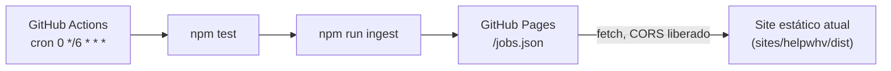

# Arquitetura — HelpWHV (Fase 1: vagas reais, site estático)

Status: **aprovado**  
Padrão escolhido: **Pipeline com adaptadores** (Ports & Adapters enxuto)

## 1. Intenção

Substituir as vagas fictícias do `app.js` por vagas reais de trabalho para quem está na Austrália com Working Holiday Visa, sem criar servidor nem banco de dados. Um processo agendado coleta as vagas, padroniza, classifica e grava um único `jobs.json`, que o frontend estático lê.

### Objetivos
- Vagas reais nas 11 categorias WHV: `Childcare`, `Cleaning`, `Construction`, `Driving`, `Farm`, `Fruit Picking`, `Hospitality`, `Other`, `Sales`, `Trades`, `Warehouse`.
- Selo de **trabalho regional para o 2º/3º visto**, calculado por categoria + postcode, separado para os subclasses **417** e **462**.
- Cada vaga com link para o anúncio original e fonte identificada.
- Núcleo de regras reaproveitável depois pela API da Fase 2.

### Fora do escopo (Fase 1)
- Login, perfil, CV, regras de autonomia e candidatura (manual ou automática).
- Banco de dados e servidor.
- Hospedagem (accommodation).

### Antiobjetivos (falha mesmo que "funcione")
- Exibir vaga, salário, data ou selo **inventados ou deduzidos sem base**. Campo ausente fica `null` e a UI mostra "não informado".
- Coletar de fontes cujos termos proíbem (Facebook, Gumtree, Seek, Indeed, LinkedIn).
- Afirmar que uma vaga "conta para o visto" sem indicar que é estimativa e sem link para a fonte oficial.
- Uma fonte com falha zerar o site.

## 2. Visão geral

```mermaid
flowchart LR
  subgraph Fontes["sources/ (únicos com acesso à rede)"]
    A[adzuna.js]
    J[jooble.js]
    P["public-pages.js<br/>(Firecrawl + allowlist)"]
  end
  A & J & P -->|RawJob[]| N
  subgraph Dominio["domain/ (puro, sem I/O)"]
    N[normalize] --> C[classify] --> R[regional88] --> D[dedupe] --> V[validate]
  end
  V --> PL[pipeline.js]
  PL --> CLI["cli.js<br/>(env, fs, guarda de regressão)"]
  CLI --> OUT[(data/jobs.json)]
  OUT --> FE["app.js (fetch)"]
```

## 3. Estrutura de pastas

```
HelpWHV/
├── ARCHITECTURE.md
├── .agents/rules/GEMINI.md
├── .github/workflows/ingest.yml  # agendamento + publicação no GitHub Pages
├── package.json               # scripts: test, ingest (sem dependências)
├── index.html  app.js  styles.css  assets/  fonts/   # frontend atual, permanece na raiz
├── app.test.js
├── data/
│   └── jobs.json              # saída gerada; contrato com o frontend
└── ingest/
    ├── src/
    │   ├── domain/
    │   │   ├── job.js           # esquema, construtores, validação
    │   │   ├── categories.js    # 11 categorias + tabela de palavras-chave
    │   │   ├── normalize.js     # RawJob → Job (pay, local, datas, tipo)
    │   │   ├── classify.js      # Job → categoria
    │   │   ├── regional88.js    # categoria + postcode + subclass → selo
    │   │   └── dedupe.js
    │   ├── sources/
    │   │   ├── adzuna.js
    │   │   ├── jooble.js
    │   │   └── public-pages.js
    │   ├── pipeline.js          # orquestra fontes → domínio; recebe dependências por parâmetro
    │   └── cli.js               # único ponto que lê process.env e escreve em disco
    ├── config/
    │   ├── sources.json         # allowlist de páginas públicas (+ checagem de termos/robots)
    │   ├── regional88-rules.json# regras por subclass 417/462, com URL e data da fonte oficial
    │   └── postcodes-88.json    # listas de postcodes oficiais, com URL e data
    └── test/
        ├── fixtures/            # respostas reais gravadas das fontes (sem dados pessoais)
        └── *.test.js
```

`sites/helpwhv/dist` continua sendo o diretório publicado do site; o `jobs.json` é publicado à parte no GitHub Pages (decisão D1, seção 8).

## 4. Fronteiras dos módulos

| Módulo | Pode | Não pode |
|---|---|---|
| `domain/` | Funções puras sobre objetos | `fetch`, `fs`, `process.env`, `Date.now()` implícito (recebe `now` por parâmetro) |
| `sources/` | Chamar a rede e mapear resposta → `RawJob` | Classificar, deduplicar, calcular selo |
| `pipeline.js` | Compor fontes e domínio; isolar falha por fonte | Ler env ou disco |
| `cli.js` | Ler env, ler `jobs.json` anterior, escrever saída | Conter regra de negócio |
| `app.js` | Ler `jobs.json` e renderizar | Reclassificar ou recalcular selo |

## 5. Contrato `data/jobs.json` (schemaVersion 1)

```json
{
  "schemaVersion": 1,
  "generatedAt": "2026-11-18T03:00:00Z",
  "sources": [
    { "id": "adzuna", "ok": true, "fetched": 240, "kept": 198, "error": null }
  ],
  "jobs": [
    {
      "id": "adzuna:4419823",
      "title": "Fruit Picker",
      "category": "Fruit Picking",
      "employmentType": "seasonal",
      "employer": "Example Orchards",
      "location": { "city": "Shepparton", "state": "VIC", "postcode": "3630" },
      "pay": { "min": 30.5, "max": null, "period": "hour", "currency": "AUD" },
      "postedAt": "2026-11-16T00:00:00Z",
      "firstSeenAt": "2026-11-17T03:00:00Z",
      "regionalWork": { "417": "likely", "462": "likely" },
      "summary": "Até 300 caracteres do anúncio.",
      "source": { "id": "adzuna", "name": "Adzuna", "url": "https://..." }
    }
  ]
}
```

Regras do contrato:
- `category` ∈ as 11 categorias; sem correspondência → `Other`.
- `employmentType` ∈ `casual | part_time | full_time | seasonal | contract | null`.
- `pay` é `null` quando a fonte não informa. Nunca converter período (ex.: anual → hora) sem a fonte declarar.
- `regionalWork[subclass]` ∈ `likely | unlikely | unknown`. `unknown` quando falta postcode ou a categoria depende de detalhe não informado. A UI sempre rotula como estimativa com link oficial.
- Mudança incompatível incrementa `schemaVersion` e atualiza este documento.

## 6. Fluxo do pipeline

1. `cli.js` monta as fontes habilitadas (chave presente no env) e chama `pipeline.run({ sources, now, previous })`. Fontes sem chave configurada no ambiente são registradas como `{ id, ok: false, skipped: true, error: "missing credentials" }` sem abortar a execução; para desenvolvimento/teste local sem chaves, `cli.js --seed` permite gerar `data/jobs.json` a partir das fixtures reais gravadas.
2. Cada fonte roda isolada; erro vira `{ ok: false, error }` no relatório, sem interromper as demais.
3. Domínio: `normalize → classify → regional88 → dedupe → validate`.
   - **classify**: tabela de palavras-chave por categoria (título primeiro, depois resumo). Sem LLM na Fase 1.
   - **dedupe**: chave = título normalizado + empregador + cidade; mantém o registro com mais campos preenchidos; `firstSeenAt` preservado do arquivo anterior.
   - **validate**: descarta registros sem `title` ou sem `source.url`.
4. Expira vagas com `postedAt` (ou `firstSeenAt`) acima de 30 dias.
5. **Guarda de regressão**: se o total cair mais de 50% em relação ao arquivo anterior, mantém o anterior e sai com erro (alerta no agendador).
6. Grava `data/jobs.json` de forma atômica (arquivo temporário + renomear).

## 7. Fontes (opção B aprovada)

| Fonte | Acesso | Env |
|---|---|---|
| Adzuna | API oficial `GET /v1/api/jobs/au/search/{page}` | `ADZUNA_APP_ID`, `ADZUNA_APP_KEY` |
| Jooble | API oficial (chave por cadastro) | `JOOBLE_API_KEY` |
| Páginas públicas | Firecrawl, somente URLs em `config/sources.json` com `robots` e termos verificados (`termsCheckedAt`) | `FIRECRAWL_API_KEY` |

Fontes proibidas: Facebook, Gumtree, Seek, Indeed, LinkedIn.  
Google Maps (fazendas/empregadores) fica para uma etapa posterior, como saída separada (`employers.json`), pois não são vagas.

## 8. Decisões

| # | Decisão | Status |
|---|---|---|
| — | Padrão Pipeline com adaptadores | Aprovado |
| — | Fase 1 estática, sem backend | Aprovado |
| — | Fontes oficiais + páginas públicas allowlist | Aprovado |
| — | Node 24, CommonJS, `node:test`, zero dependências | Definido (escolha técnica) |
| — | Classificação por regras, sem LLM na Fase 1 | Definido (escolha técnica) |
| — | Selo separado para 417 e 462; padrão `462` na UI com alternância para `417` salva em `localStorage` | Definido (escolha técnica) |
| D1 | GitHub Actions (cron a cada 6 h) gera `jobs.json` e publica no GitHub Pages; `app.js` lê dessa URL. Site atual não é republicado. Chaves em GitHub Secrets | Aprovado |

### D1 — Publicação



- Pré-requisito: inicializar git no projeto e criar repositório no GitHub.
- Workflow: `.github/workflows/ingest.yml`. Testes falhando bloqueiam a publicação.
- O `jobs.json` anterior é baixado do Pages no início do job, para preservar `firstSeenAt` e aplicar a guarda de regressão.
- `app.js` recebe a URL de dados por uma constante única (`JOBS_URL`); em desenvolvimento local usa `data/jobs.json`.
- Falha do job: o Pages mantém o último `jobs.json` válido; o site mostra `generatedAt` ("atualizado há X horas").

## 9. Mudanças no frontend (Fase 1)

- `app.js` carrega `jobs.json` via `fetch` (`JOBS_URL`, com fallback local para `data/jobs.json`), com estados de carregando, erro e nenhuma vaga.
- Mapeador `toViewJob` isola o contrato da renderização.
- **Filtros e ordenação com dados reais (escolhas técnicas):**
  - **Categorias (`Job Type`):** barra de chips de seleção múltipla com as 11 categorias WHV; nenhuma selecionada = todas.
  - **Local:** `<select>` preenchido dinamicamente com as cidades presentes em `jobs.json` (ordenadas de A–Z), em vez de lista fixa.
  - **Salário e ausência de valor:** quando `filters.salary === 0` ("Qualquer valor"), vagas com `pay: null` ou período não-horário permanecem visíveis (exibindo "Salário não informado" ou o período original); quando um mínimo em `A$/h` é filtrado, apenas vagas com `pay.period === "hour"` e `(pay.max ?? pay.min) >= filters.salary` entram. Na ordenação por maior salário, vagas sem valor em `A$/h` ficam ao final.
  - **Selo e filtro 88 dias:** seletor de visto `462` (padrão) / `417` salvo em `localStorage`, selo "88 dias · estimativa" com link para a página oficial do Home Affairs quando `regionalWork[subclass] === "likely"`, e filtro rápido "Apenas vagas elegíveis 88 dias".
  - **Link original:** cada vaga mostra a fonte (`source.name`) e link externo (`target="_blank" rel="noopener noreferrer"`) para `source.url`.
- Tag "Prévia · dados fictícios" sai da lista de vagas; botões de candidatura com IA continuam marcados como prévia.
- Testes do frontend (`app.test.js`) usam fixtures do contrato `jobs.json`, mantendo compatibilidade das funções exportadas.
- Script de sincronização copia os arquivos atualizados da raiz para `sites/helpwhv/dist/`.

## 10. Testes

- TDD: teste falhando antes de cada regra de domínio.
- Domínio testado sem rede, com fixtures gravadas das fontes em `ingest/test/fixtures/`.
- Adaptadores testados com `fetch` injetado (stub).
- `npm test` = `node --test`.
